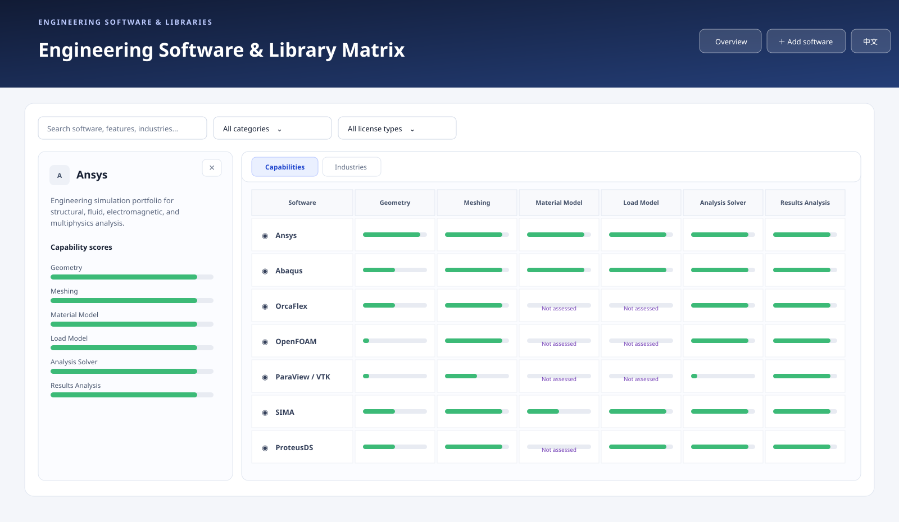

# Engineering Software & Library Matrix

A reader-friendly directory for exploring engineering software and libraries. Compare tools by the work they support, the industries where they are used, and their license type.



## Explore the catalog

- Search by product name, capability, industry, or use case.
- Filter by software category and license type.
- Switch between capability and industry views.
- Select a software name or score bar to open its details beside the matrix.
- Sort the matrix by clicking a column heading. The default order groups open-source tools first and commercial tools last.
- Switch the interface between English and Chinese using the language button.

The six capability dimensions are **Geometry**, **Meshing**, **Material Model**, **Load Model**, **Analysis Solver**, and **Results Analysis**. Scores are shown as visual bars and stored as numbers from 1 to 10. A missing score means **Not assessed**; it does not mean the software lacks that capability.

## Suggest a software or library

Choose **Add software** and submit the survey as a GitHub issue. The issue is a proposal for review. After verifying the product details, license, use cases, and scores, an approved entry can be added to [`data/software.json`](data/software.json).

## Catalog and project-language data

The catalog is maintained in `data/software.json`, which the page loads when it opens. Update this file to add or revise entries; the page does not write submitted suggestions into the catalog automatically.

Each record can include a `programmingLanguages` list, for example:

```json
{
  "name": "Example Library",
  "license": "Open source",
  "programmingLanguages": ["C++", "Python"]
}
```

For open-source entries linked directly to a GitHub repository, the details panel also retrieves the repository's language statistics from GitHub when available. These statistics are based on source-code size and may differ from the project's full language/toolchain requirements. For other project websites, add a reviewed `programmingLanguages` list to the JSON record. Language data may be unavailable if GitHub cannot be reached or its API rate limit is exceeded.

## How to read the catalog

- Scores are comparative research notes, not benchmarks or certification results.
- License labels summarize the listed product at a high level. Check the vendor or project license for the exact version, edition, and use case.
- Industries and use cases describe the current catalog scope; they do not imply exclusive or officially endorsed applications.
- Product capabilities and licensing can change. Verify details with the linked project or vendor before making a purchasing or engineering decision.

## Project files

- [`index.html`](index.html) — matrix interface and details panel.
- [`data/software.json`](data/software.json) — software records used by the site.
- [`assets/preview.svg`](assets/preview.svg) — README preview image.
